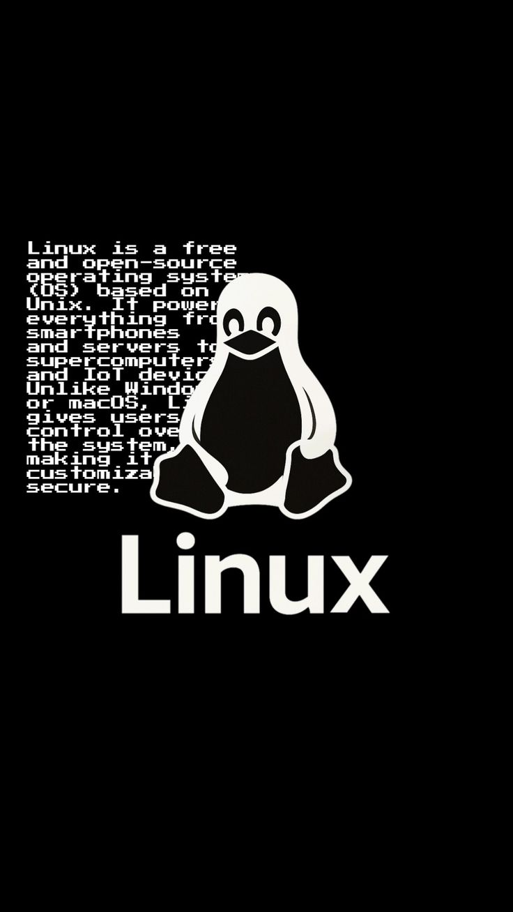

<p align="center">
  
</p>

<p align="center">
  
</p>

<p align="center">
  
  
  
  
  
  
</p>

```console
[labadmin@oxa-linux01 ~]$ neofetch --oxa
 ───────────────────────────────────────────
  OS ........ Fedora Linux
  Host ...... VMware Workstation (Windows 10)
  Hostname .. oxa-linux01
  Network ... Host-only (VMnet1)
  Shell ..... Bash
  Init ...... systemd
  Firewall .. firewalld
  MAC ....... SELinux (enforcing)
  Audit ..... auditd
  Data ...... /srv/oxa
  Project ... OXA-LNX-01  [ IN PROGRESS ]
 ───────────────────────────────────────────
```

## `man oxa` — Overview

**Lab 01** is a hands-on Linux administration and security project. It prepares, hardens, monitors and automates a Fedora server for a fictional company, **OXA**.

The goal is to go beyond isolated commands. Every change is configured, tested, and backed by evidence (output and screenshots) so the whole workflow is repeatable and documented.

| Field        | Value                        |
| :----------- | :--------------------------- |
| Project ID   | `OXA-LNX-01`                 |
| Server       | `oxa-linux01`                |
| Environment  | Fedora Linux VM in VMware Workstation |
| Admin client | Windows 10 / PowerShell      |
| Level        | Intermediate                 |
| Status       | In progress                  |

---

## `tree /` — Infrastructure Map

The animation shows the lab's SSH policy at work. A `labadmin` login with a key reaches the server. `root` and `analyst` are refused at sshd.

<p align="center">
  
</p>

| Component                | Configuration                |
| :----------------------- | :--------------------------- |
| Hypervisor               | VMware Workstation           |
| Management network       | Host-only (VMnet1); optional second NAT adapter for DNF |
| Administrative account   | `labadmin` (`wheel`, `itops`) |
| Standard account         | `analyst` (`employees`)      |
| Company data             | `/srv/oxa`                   |
| Remote access            | OpenSSH, TCP 22, key authentication |
| Firewall                 | firewalld                    |
| Mandatory Access Control | SELinux (enforcing)          |
| Auditing                 | auditd                       |
| Automation               | Bash and systemd timer       |
| Backups                  | `/var/backups/oxa`           |

---

## `./roadmap.sh` — Implementation Phases

| Phase | Implementation               | Key Commands                                          |
| :---: | :--------------------------- | :---------------------------------------------------- |
|  `00` | VM preparation and snapshot  | VMware snapshot, `ip`, `nmcli`                        |
|  `01` | Fedora initialization        | `hostnamectl` `dnf` `ip` `ping`                       |
|  `02` | Users, groups, permissions   | `useradd` `usermod` `chmod` `chown` `getfacl`         |
|  `03` | SSH and remote administration | `ssh-keygen` `sshd -t` `sshd -T`                     |
|  `04` | firewalld and SELinux        | `firewall-cmd` `getenforce` `semanage` `restorecon`   |
|  `05` | Audit and monitoring         | `auditctl` `ausearch` `journalctl`                    |
|  `06` | Backups with Bash and systemd | `tar` `systemctl` `systemd-analyze`                  |
|  `07` | Final validation             | `ss` `systemctl --failed` `ls -Z`                     |

<details>
<summary><code>[00]</code> VM preparation</summary>

Set the VMware adapter to Host-only, identify the real interface, IP and route (never reuse an old address), and create the snapshot `OXA-BEFORE-LAB01`.
</details>

<details>
<summary><code>[01]</code> Fedora initialization</summary>

Collect system information, set the hostname `oxa-linux01`, run `dnf upgrade --refresh`, install the lab tools (`openssh-server`, `firewalld`, `audit`, `rsync`, `acl`, `policycoreutils-python-utils`, `git`, `tar`) and verify IP and DNS connectivity.
</details>

<details>
<summary><code>[02]</code> Users, groups and permissions</summary>

Create the groups `itops` and `employees` and the accounts `labadmin` and `analyst`. Build `/srv/oxa/administration` (`root:itops`, mode `2770`) and `/srv/oxa/shared` (`root:employees`, mode `2770`). The setgid bit makes new files inherit the group. Test one expected failure: `analyst` must be refused in `administration`.
</details>

<details>
<summary><code>[03]</code> SSH and remote administration</summary>

Generate an `ed25519` key on Windows and install the public key for `labadmin`. Apply the hardening file, validate it with `sshd -t`, check effective values with `sshd -T`, and disable password login only after the key login is confirmed from a second window.
</details>

<details>
<summary><code>[04]</code> firewalld and SELinux</summary>

Allow SSH only in the zone that really carries the management interface. Keep SELinux in `Enforcing`, then add a persistent context for `/srv/oxa/webdata` with `semanage fcontext` and `restorecon`. No web server is deployed in this lab.
</details>

<details>
<summary><code>[05]</code> Audit and monitoring</summary>

Enable `auditd`, load persistent rules from `/etc/audit/rules.d/oxa.rules`, create a test event, and find it with `ausearch -k oxa_admin_directory`. Review SSH and warning-level journal entries and check for failed units.
</details>

<details>
<summary><code>[06]</code> Backups with Bash and systemd</summary>

Write `oxa-backup.sh`, which creates a dated, verified `tar.gz` of `/srv/oxa` in `/var/backups/oxa` with mode `600`. Restore it into `/tmp/oxa-restore-test`, then schedule it daily at 02:00 with a service and a timer.
</details>

<details>
<summary><code>[07]</code> Final validation</summary>

Run the full verification series and compare the results with the acceptance criteria below.
</details>

---

## `sudo hardening --layers` — Security Architecture

| Layer                    | Implementation          | Purpose                            |
| :----------------------- | :---------------------- | :--------------------------------- |
| Identity                 | Local accounts, groups  | Account separation                 |
| Authorization            | Permissions, setgid, ACL | Resource access control           |
| Remote access            | OpenSSH, ed25519 keys   | Secure administration              |
| Network protection       | firewalld               | Traffic filtering                  |
| Mandatory Access Control | SELinux                 | Confinement and policy enforcement |
| Auditing                 | auditd                  | Security event records             |
| Automation               | systemd timer           | Scheduled, repeatable operations   |

```text
[*] Least Privilege            [*] Defense in Depth
[*] Account Separation         [*] Secure Remote Administration
[*] Controlled Resource Access [*] Security Event Auditing
[*] Repeatable Administration
```

---

## `cat /etc/ssh/sshd_config.d/10-oxa-hardening.conf`

```text
PermitRootLogin no
PubkeyAuthentication yes
PasswordAuthentication no      # set to yes during setup, switch only after the key login works
MaxAuthTries 3
X11Forwarding no
AllowGroups wheel
```

## `cat /etc/audit/rules.d/oxa.rules`

```text
-w /etc/passwd -p wa -k oxa_identity_changes
-w /etc/group -p wa -k oxa_group_changes
-w /etc/sudoers -p wa -k oxa_sudo_changes
-w /srv/oxa/administration -p wa -k oxa_admin_directory
```

---

## `systemctl list-timers` — Automation

```text
   /srv/oxa
      │
      ▼
 oxa-backup.sh         /usr/local/sbin  ->  scripts/oxa-backup.sh
      │  tar -czf + tar -tzf verification, mode 600
      ▼
 /var/backups/oxa      oxa-YYYY-MM-DD_HH-MM-SS.tar.gz
      │
      ▼
 oxa-backup.service    Type=oneshot
      │
      ▼
 oxa-backup.timer      OnCalendar=*-*-* 02:00:00  Persistent=true
```

> The backup is local and meant for learning. In production, copy archives to separate storage and test restores regularly.

---

## `journalctl -u evidence` — Acceptance Criteria

| Control                | Expected result                                   | Status |
| :--------------------- | :------------------------------------------------ | :----: |
| Hostname               | `oxa-linux01`                                     | `PEND` |
| `labadmin`             | Member of `wheel` and `itops`                     | `PEND` |
| `analyst`              | Member of `employees`, not `wheel`                | `PEND` |
| `/srv/oxa/administration` | Write allowed for `labadmin`, refused for `analyst` | `PEND` |
| SSH                    | Key login from Windows works                      | `PEND` |
| SSH root               | `PermitRootLogin no`                              | `PEND` |
| SSH password           | `no`, only after the key login is validated       | `PEND` |
| firewalld              | Active, SSH allowed in the management zone        | `PEND` |
| SELinux                | Enforcing                                         | `PEND` |
| auditd                 | Active, 4 OXA rules loaded, test event found      | `PEND` |
| Backup                 | Archive created, readable and restored in test dir | `PEND` |
| Timer                  | `oxa-backup.timer` enabled                        | `PEND` |

Update a status to `OK` only after the real test has passed.

### Screenshots

All evidence is real output, captured right after each step is validated and stored in [`screenshots/`](screenshots/).

| #  | File                                   | Shows                                     |
| :- | :------------------------------------- | :---------------------------------------- |
| 00 | `00-VMware-Network-Settings.png`       | Network adapter set to Host-only          |
| 01 | `01-Fedora-Network-Baseline.png`       | `ip -br address`, `ip route`, `nmcli`     |
| 02 | `02-System-Inventory.png`              | OS, kernel, RAM, disk                     |
| 03 | `03-OXA-Hostname.png`                  | `oxa-linux01` static hostname             |
| 04 | `04-Network-Connectivity.png`          | IP, route, ping tests                     |
| 05 | `05-OXA-Users-Groups.png`              | `id` and `getent group`                   |
| 06 | `06-OXA-Directory-Permissions.png`     | `ls -ld`, `getfacl`, analyst refusal      |
| 07 | `07-OXA-SSH-Windows.png`               | Key-based SSH from PowerShell             |
| 08 | `08-OXA-SSH-Hardening.png`             | `sshd -T` effective settings              |
| 09 | `09-OXA-Firewalld.png`                 | Active zone and SSH service              |
| 10 | `10-OXA-SELinux.png`                   | Enforcing and `httpd_sys_content_t`       |
| 11 | `11-OXA-Audit-Rules.png`               | `auditctl -l`, four rules                 |
| 12 | `12-OXA-Audit-Test.png`                | `ausearch` test event                     |
| 13 | `13-OXA-System-Monitoring.png`         | `top`, `free`, `df`, `systemctl --failed` |
| 14 | `14-OXA-Backup-Script.png`             | Backup script content                     |
| 15 | `15-OXA-Backup-Archive.png`            | Archive and `tar -tzf` check              |
| 16 | `16-OXA-Backup-Restore.png`            | Restored files in the test directory      |
| 17 | `17-OXA-Systemd-Timer.png`             | Timer and successful service run          |
| 18 | `18-OXA-Final-Validation.png`          | Final checks and active services          |

---

## `ls -la` — Repository Structure

```text
OXA-Linux-Infrastructure/
│
├── README.md
│
├── assets/
│   ├── Linux.png
│   └── joinus.png
│
├── documentation/
│   ├── OXA_Linux_Lab_01_Complete_Guide.pdf
│   └── architecture/
│
├── configurations/
│   ├── ssh/
│   ├── firewalld/
│   └── audit/
│
├── scripts/
│   └── oxa-backup.sh
│
├── systemd/
│   ├── oxa-backup.service
│   └── oxa-backup.timer
│
├── screenshots/
│   ├── phase-00/
│   ├── phase-01/
│   ├── phase-02/
│   ├── phase-03/
│   ├── phase-04/
│   ├── phase-05/
│   ├── phase-06/
│   └── phase-07/
│
└── .gitignore
```

---

## `systemctl status oxa` — Project Status

```text
[  OK   ]  Fedora installation
[  OK   ]  VMware environment
[ PEND  ]  Phase 01  Fedora initialization
[ PEND  ]  Phase 02  Identity and permissions
[ PEND  ]  Phase 03  SSH remote administration
[ PEND  ]  Phase 04  firewalld and SELinux
[ PEND  ]  Phase 05  auditd
[ PEND  ]  Phase 06  Backup automation
[ WAIT  ]  Phase 07  Final validation
```

Status is updated as each phase is implemented and tested.

## `cat /etc/motd` — Security Notes

- No passwords, private SSH keys (`id_ed25519`), tokens or recovery codes are ever committed. Check `.gitignore` before every `git push`.
- Never disable SELinux to hide an error. Fix the context or policy instead.
- Keep a working SSH session open while hardening, and test from a second window.
- Adapt IP addresses and firewalld zones to your own lab. Do not copy addresses from another setup.
- Real backup archives (`*.tar.gz`) stay out of the repository.

## `less docs/` — Troubleshooting

Problems, causes, fixes and proof of the fix are logged in [`docs/troubleshooting.md`](docs/troubleshooting.md). A documented and understood failure is better than a screenshot that hides it.

---

<p align="center">
  <strong>Network &amp; Cybersecurity Student</strong> · <a href="https://github.com/A-straya">github.com/A-straya</a>
  <br>
  <code>BUILD · SECURE · AUTOMATE · DOCUMENT</code>
  <br>
  <sub>[labadmin@oxa-linux01 ~]$ <code>exit</code></sub>
</p>
